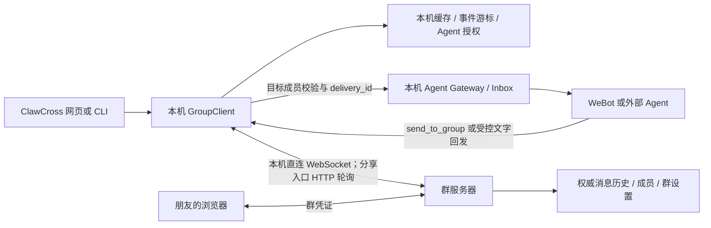

# 群聊服务器与客户端梳理

检查日期：2026-10-20。按当前工作区代码检查，包含尚未提交的修改。
ClawCross 的提交基线为 `e97ff8c`；Hub 的提交基线为 `d207bec`。

本文记录代码审查结论，没有在真实用户数据库中创建、删除群聊，也没有以真实用户身份收发测试消息。

## 结论

目前具备独立群服务器和客户端的基本结构，可以作为轻量群聊使用。
本次已修正并发发送结果、补齐持久化重试和独立的设备送达/成员已读回执。
Python 群服务器与 Hub 实际托管的群服务器共享基础协议及管理能力；主机管理入口和传输方式仍因部署不同而不同。
成员与设备的完整身份拆分、账号联邦和高可用不属于本次修复范围。

## 各部分的职责

- **Python 群服务器**：`src/backend/groups/server.py`、`relay_api.py`、`relay_store.py`；单独进程，默认端口 51203，保存 `group-relay.db`。
- **ClawCross 客户端**：`src/backend/groups/client.py` 中的 `GroupClient` 和 `ClientStore`。缓存、游标、连接凭证、本机用户和允许加入的 Agent 在本机管理。
- **旧群兼容层**：`facade.py` 仍会合并旧 `/local/groups` 和新 relay 群；新建群走 relay 客户端。旧本地 `read_cursor` 不能代表新协议已经有统一已读回执。
- **Hub 群服务器**：`ClawCrossHub/lib/groups/store.ts` 与 `app/groups/relay/[...path]/route.ts`；同类协议的 TypeScript 实现，保存自己的 `groups.sqlite3`，目前设备入口主要用 HTTP 轮询。
- **浏览器个人 Agent**：模型请求、个人记忆和工作区由浏览器端运行时管理，群服务器不会因此获得调用本机 Agent API 的权限。
- **Hub 公网转发**：为本机网页提供访问通道。使用 Hub 子域名不会自动把本机群的消息数据库搬到 Hub。需要主机关机后朋友仍能聊天，应将群本身建立在持续在线的群服务器上。

## 当前能力

| 能力 | 代码检查结论 |
| --- | --- |
| 群服务器不依赖 Agent 后端运行 | 具备；成员自己引入 Agent，由各自设备执行 |
| 群历史权威来源 | 服务端 SQLite；客户端保留有限缓存，主客户端最多缓存 2000 个事件 |
| 登录与消息身份 | 群连接凭证确定发送者；`user_id`、`node_id` 是自报标签，不能作为跨站账号认证 |
| 成员和 Agent 权限 | 服务端校验发送者归属、引用和 @ 目标；主客户端再次校验本机 owner 和 `allowed_agents` |
| 断线补收 | 主客户端保存事件游标并退避重连；通过分享页加入时轮询补收 |
| 消息去重 | 服务端有 `(group_id, sender, client_id)` 唯一约束；调用方需要在重试时复用同一个 ID |
| Agent Inbox 去重 | 投递前检查成员、目标和授权；使用稳定 `delivery_id`，本机记录已投递事件 |
| 历史翻页与 Agent 唤醒分离 | 新 `GroupClient.history()` 从服务端分页获取历史，不把历史当成新增 Inbox 事件 |
| 群资料、公告、搜索和引用 | 两端具备基本能力；不能据此认为所有管理动作已经对齐 |
| 本机群服务器管理 | Python 端有仅本机可访问的管理页及全局联网开关，关闭联网不删除群或历史 |
| 已送达、已读 | 两端持久保存每成员、每设备的 received_cursor/read_cursor，按成员汇总；原 ACK 继续表示同步进度 |
| 浏览器关闭后的 Agent 运行 | 浏览器 Agent 不会继续调用模型；已有连接重开时按保存的游标补收。ClawCross 后端 Agent 取决于后端进程是否运行 |

## 优先补齐的具体问题

### 1. 持久化发送队列和确定的发送结果

已实现：`GroupClient` 在客户端 SQLite 保存 outbox，网页人类发送在 IndexedDB 保存待发送状态。
发送前落盘、重试复用同一个 `client_msg_id`，收到有效服务器确认后清理队列。
超时、暂时不可用和限流继续重试；无效身份、禁言等永久拒绝停止自动重试。
主客户端每次重试重新检查本机用户、原 connection_id 与 Agent 授权，本机移除群时清理该群 outbox。
文字自动回发也经过相同队列，不再静默丢弃网络失败。
浏览器重开后在页面运行期间重试，浏览器关闭时不继续执行。

`GroupClient.post()` 现在直接规范化本次服务器响应的确切消息，不再从缓存取“最后一条”。
接收处理按连接串行，拒绝乱序事件；历史查询与实时游标继续分开。
连续补收的 `received_cursor` 与 Agent 投递处理的 `cursor` 分开保存。
单独 POST 确认只缓存消息，不推进补收位置；正常消息列表只展示连续补收到的位置，避免跳过较早的在途消息。
消息批次先原子落库，Agent 暂不接受 Inbox 时也不阻塞人类查看已收到的消息。
移动消息中心发送时固定捕获原群号，切换聊天不会改变在途发送的目标。

### 2. 成员身份和设备会话分开

两端当前用群内名字与密码找回同一 `connection_id`，再签发新的 token。
虽然保留多条凭证支持同时登录，用户身份和设备身份仍混在一层：旧连接的 `node_id`、`user_id` 不会成为新设备的独立会话记录，Agent 归属也挂在同一个连接上。

后续应逐步分成：`member/account → device_session → agent_presence`。
群昵称属于成员，游标和在线状态属于设备；Agent 的本机授权与注册归属明确到设备。
不需要一次重写现有库，可以先为新设备引入独立会话，保留旧 token 的迁移映射。

### 3. 两种群服务器的能力需要对齐

已为 Hub 实际托管的群补齐 `member_patch`、禁言、主 Agent、dnd 及外部联网暂停/恢复。
两端 `/relay/health`、`/relay/capabilities`、轮询和浏览器 state 返回同一基础能力格式。
能力由实际群服务器声明；Hub 只转发端口时原样透传，不依据域名判断服务器实现。
Python 主机本地连接在暂停时保留；Hub 托管群保留群主的管理连接，其他成员等待恢复。
两端消息及回执使用相同字段，HTTP 轮询和 WebSocket 的差异不影响消息含义。

### 4. ACK、Agent 接受和用户已读分别记录

当前游标代表客户端处理到哪里；`gateway.inbox().accepted` 代表 Agent 运行时接受了消息。
两者都不是用户已读。新增 `POST /relay/receipts`，以群凭证确定成员，`device_id` 仅区分该成员的设备，不授予额外权限。
`received_cursor` 在持久保存消息后推进；`read_cursor` 仅在对话可见且消息进入视区后提交，后台轮询与历史搜索不提交已读。
回执单调前进、校验群归属与设备接收位置，在 poll/WS/state 元数据中传播，不写入聊天事件也不触发 Inbox。
Agent 接受消息和运行完成仍是独立业务状态，不冒充人类已读。

### 5. 运维与边界

- Python 端具备仅本机管理入口；Hub 仍需对齐部署者管理能力。
- `normalize_url()` 仍接受非本机 HTTP。远程凭证访问应统一采用 HTTPS；本机回环可保留 HTTP。
- 群历史长期保留在 SQLite；备份、保留策略和容量告警需要明确。
- 当前是单机存储与应用内限流，适合先做小规模可靠通讯；高可用、跨实例限流可以后续再做。
- 当前没有端到端加密，不应向用户宣称只有收发双方能看到群消息。

## Hub 体验 Key 的边界

体验 Key 只用于模型调用，不能充当群连接凭证、群管理凭证或本机管理 token。
供应商原始 Key 只保留在 Hub；本机继续承担个人 Agent 的工具权限、工作区、Inbox 和群身份校验。
接入接口、现有能力与待实现项见 Hub 仓库的 `docs/trial-key-integration.md`。

## 建议顺序

1. 本次已落实精确发送确认、持久化重试、基础能力对齐与设备回执。
2. 后续独立处理完整的成员/设备会话身份拆分，保留已有成员与历史。
3. Hub 模型体验 Key 接口仍是准备方案，未因本次群协议修复自动启用。

这些工作可以沿用现有 SQLite 和服务进程完成，当前不需要新增消息队列或把群聊引入 Agent Gateway 内部。
